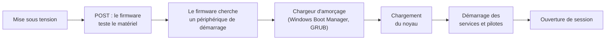

# Cours – Système d'exploitation, démarrage et Windows

*BTS SIO SISR 1re année – S04 – à lire avant le [TP](02-tp.md)*

## À la fin de ce cours, tu sauras

- [ ] expliquer ce que fait un **système d'exploitation** ;
- [ ] décrire la **séquence de démarrage** d'un poste ;
- [ ] distinguer **BIOS** et **UEFI**, **MBR** et **GPT** ;
- [ ] expliquer la différence entre un système **32 bits** et **64 bits** ;
- [ ] distinguer logiciel **libre**, **gratuit** et **payant** ;
- [ ] citer les **mesures de base** qui protègent un système ;
- [ ] nommer et utiliser les **outils d'observation** de Windows.

---

## 1. Le système d'exploitation

Le **système d'exploitation** (SE, ou *operating system*, OS) est le logiciel de base qui fait le lien entre le **matériel** et les **applications**. Sans lui, chaque application devrait piloter elle-même les disques, l'écran, le réseau.

| Rôle | Ce que fait le système | Exemple |
|---|---|---|
| **Matériel** | Pilote le processeur, la mémoire, les périphériques, grâce aux **pilotes** (*drivers*) | Windows installe un pilote pour reconnaître une imprimante |
| **Fichiers et stockage** | Organise les données dans un **système de fichiers** (NTFS, exFAT, FAT32, ext4…) ; gère les droits d'accès | `C:\Users` sous Windows, `/home` sous Linux |
| **Processus et mémoire** | Lance les programmes, répartit le processeur et la RAM entre eux (**ordonnancement**), permet le **multitâche** | Deux applications ouvertes en même temps |
| **Interface** | Graphique (**GUI**) ou en ligne de commande (**CLI**) | Bureau Windows ; PowerShell ; bash |
| **Sécurité** | Comptes, mots de passe, droits, pare-feu, mises à jour de sécurité | Un utilisateur standard ne peut pas modifier le système |

Le **noyau** (*kernel*) est le cœur du système : il gère le matériel, les processus et la mémoire. Les applications lui demandent des services plutôt que de toucher le matériel directement.

**Exemples.** Postes : Windows 10/11, macOS, Linux (Debian, Ubuntu, Fedora…). Smartphones : Android, iOS. Serveurs : Windows Server, Linux (Debian, Red Hat, Ubuntu Server…), FreeBSD.

## 2. La séquence de démarrage

Entre la mise sous tension et le bureau, plusieurs étapes s'enchaînent :

- **POST** (*Power-On Self-Test*) : au démarrage, le firmware vérifie que les composants essentiels (processeur, mémoire, etc.) répondent. En cas d'erreur, il signale souvent un code sonore ou lumineux.
- Le **chargeur d'amorçage** (*bootloader*) est le petit programme qui sait charger le noyau d'un système donné. Windows et Linux ont chacun le leur.

## 3. BIOS, UEFI, MBR et GPT

Le **firmware** de la carte mère est le premier code exécuté. Il existe en deux générations :

| | BIOS (historique) | UEFI (actuel) |
|---|---|---|
| **Signification** | *Basic Input/Output System* | *Unified Extensible Firmware Interface* |
| **Schéma de partitions** | **MBR** | **GPT** (accepte aussi le MBR en mode de compatibilité) |
| **Taille de disque** | partitions limitées à environ 2,2 To | beaucoup plus grandes |
| **Fonctions** | simples, interface texte | démarrage plus rapide, interface graphique possible, **démarrage sécurisé** (*Secure Boot*) |

**Pourquoi 2,2 To ?** Le MBR code la taille d'une partition sur **32 bits**, en secteurs de **512 octets** : 2³² × 512 = 2 199 023 255 552 octets, soit environ 2,2 To (2 Tio). Le **MBR** permet aussi au plus **4 partitions primaires**. Le **GPT** (*GUID Partition Table*) lève ces limites.

**Démarrage sécurisé.** Avec **Secure Boot**, le firmware ne lance que des chargeurs d'amorçage **signés** par une autorité reconnue : cela empêche un code malveillant de s'insérer avant le système. Windows 11 l'exige avec un **TPM 2.0** (puce de sécurité qui stocke des clés de manière protégée).

**Accéder au firmware.** On appuie sur une touche pendant le démarrage (souvent `Suppr`, `F2` ou `F10`, **selon le constructeur**) ; sous Windows, on peut aussi demander un redémarrage vers les paramètres du firmware depuis le démarrage avancé. On y règle notamment l'**ordre de démarrage** (disque, clé USB, réseau).

> [!WARNING]
> Le firmware n'est **pas** à modifier à la légère : un mauvais réglage (par exemple changer le mode de démarrage d'un poste installé) peut empêcher le système de démarrer. En salle de TP, on **observe** sans modifier.

## 4. 16, 32 et 64 bits

Le nombre de bits désigne la **taille des registres** du processeur et des adresses mémoire : plus il est grand, plus on peut **adresser de mémoire** et manipuler de données en une opération.

| Système | Mémoire adressable | Remarque |
|---|---|---|
| **16 bits** | très petite (65 536 adresses de base) | historique (MS-DOS, premières versions de Windows) |
| **32 bits** | **4 Gio** maximum en théorie | souvent moins de mémoire utilisable ; encore présent dans l'embarqué et les très anciens postes |
| **64 bits** | bien au-delà de ce que les machines installent (plus de To en pratique) | norme actuelle des postes et des serveurs |

- Un système **64 bits** exécute généralement les logiciels 32 bits (compatibilité), mais un système **32 bits** n'exécute **pas** de logiciel 64 bits.
- Conséquence pratique : un poste avec **16 Go** de RAM ne profite de cette mémoire qu'avec un système **64 bits**.
- Un serveur qui doit héberger plusieurs services (annuaire, base de données, serveur Web) a besoin de beaucoup de mémoire : les systèmes serveurs récents ne sont proposés qu'en **64 bits**.

## 5. Logiciels : libre, gratuit, payant

| Type | Définition | Exemples (à vérifier dans les licences) |
|---|---|---|
| **Libre** | Le code source est accessible et la licence autorise de l'**utiliser, étudier, modifier et redistribuer** | Linux, LibreOffice, Firefox |
| **Gratuit** (gratuiciel) | Utilisable sans payer, mais **sans** accès libre au code | Un navigateur ou un lecteur distribué gratuitement par un éditeur |
| **Payant** (propriétaire commercial) | Nécessite l'achat d'une **licence** ou d'un abonnement | Suites bureautiques ou logiciels de création payants |

> [!WARNING]
> **Libre ne veut pas dire gratuit, et gratuit ne veut pas dire libre.** Un logiciel libre peut être vendu (support, distribution) ; un logiciel gratuit peut interdire de lire son code, de le modifier ou de l'utiliser en entreprise. La **licence** décide : on la **lit** avant d'installer un logiciel pour une organisation.

**Programme ou logiciel ?** Un **programme** est une suite d'instructions exécutable ; un **logiciel** est un ensemble structuré de programmes et de ressources, souvent avec une interface.

## 6. Mises à jour et protection du système

**Pourquoi mettre à jour ?** Corriger des **bogues**, combler des **failles de sécurité**, ajouter des **fonctionnalités**. **Comment ?** Automatiquement (Windows Update, gestionnaire de paquets) ou manuellement (site de l'éditeur, avec vérification de la source). Un système dont le **support est terminé** ne reçoit plus de correctifs de sécurité : il devient une cible.

**Protéger un système : les bases.**

| Mesure | Pourquoi |
|---|---|
| **Mises à jour** régulières du système et des logiciels | Les failles connues sont exploitées vite |
| **Antivirus / antimalware** actif et à jour | Détecte et bloque les codes malveillants |
| **Pare-feu** activé | Filtre les connexions entrantes et sortantes |
| **Comptes séparés** : un compte **standard** pour le travail courant, un compte **administrateur** pour l'administration | Principe du **moindre privilège** : une erreur ou un virus a moins de droits |
| **Mots de passe** solides, authentification multifacteur quand c'est possible | Évite l'usurpation de compte |
| **Chiffrement du disque** (BitLocker sous Windows) | Protège les données si le poste est volé |
| **Sauvegardes** | Permettent de restaurer après une panne ou un chiffrement par un rançongiciel |
| **Démarrage sécurisé** | Empêche l'insertion de code avant le système |

Sous Windows, **UAC** (*User Account Control*) demande une confirmation avant toute action qui exige des droits d'administrateur.

## 7. Plusieurs systèmes sur une machine

Oui, de plusieurs manières :

- **Multiboot** (démarrage double ou multiple) : plusieurs systèmes installés sur la même machine, choisis au démarrage ;
- **Machine virtuelle** : un système tourne **dans une fenêtre** sur un autre (S06) ;
- **WSL** (*Windows Subsystem for Linux*) : Windows lance un environnement Linux. **WSL 2** s'appuie sur une machine virtuelle légère avec un noyau Linux fourni par Microsoft.

## 8. Les outils d'observation de Windows

| Besoin | Outil graphique | PowerShell / CMD |
|---|---|---|
| Voir les processus et la charge | Gestionnaire des tâches (`Ctrl + Maj + Échap`) | `Get-Process` · `tasklist` |
| Voir et gérer les **services** | Services (`services.msc`) | `Get-Service` |
| Lire les **journaux** du système | Observateur d'événements (`eventvwr`) | `Get-WinEvent -LogName System -MaxEvents 5` |
| Voir les disques et partitions | Gestion des disques (`diskmgmt.msc`) | `Get-Disk` · `Get-Partition` |
| Voir les infos système | Informations système (`msinfo32`) | `Get-ComputerInfo` · `systeminfo` |
| Voir les comptes locaux | Gestion de l'ordinateur | `Get-LocalUser` · `whoami /groups` |

Un **service** est un programme qui tourne en arrière-plan, sans fenêtre (par exemple le service de mise à jour ou d'impression).

---

## À retenir

- Le **système d'exploitation** gère le matériel, les fichiers, les processus et la mémoire, l'interface et la sécurité.
- Démarrage : **POST → firmware → chargeur d'amorçage → noyau → services → session**.
- **UEFI + GPT** remplacent **BIOS + MBR** (limite de 2,2 To, 4 partitions primaires). **Secure Boot** et **TPM** sont exigés par Windows 11.
- **64 bits** : nécessaire pour utiliser plus de 4 Gio de RAM ; un logiciel 64 bits ne tourne pas sur un système 32 bits.
- **Libre ≠ gratuit.** On **lit la licence**.
- Protéger un poste : **mises à jour, antivirus, pare-feu, moindre privilège, chiffrement, sauvegardes**.
