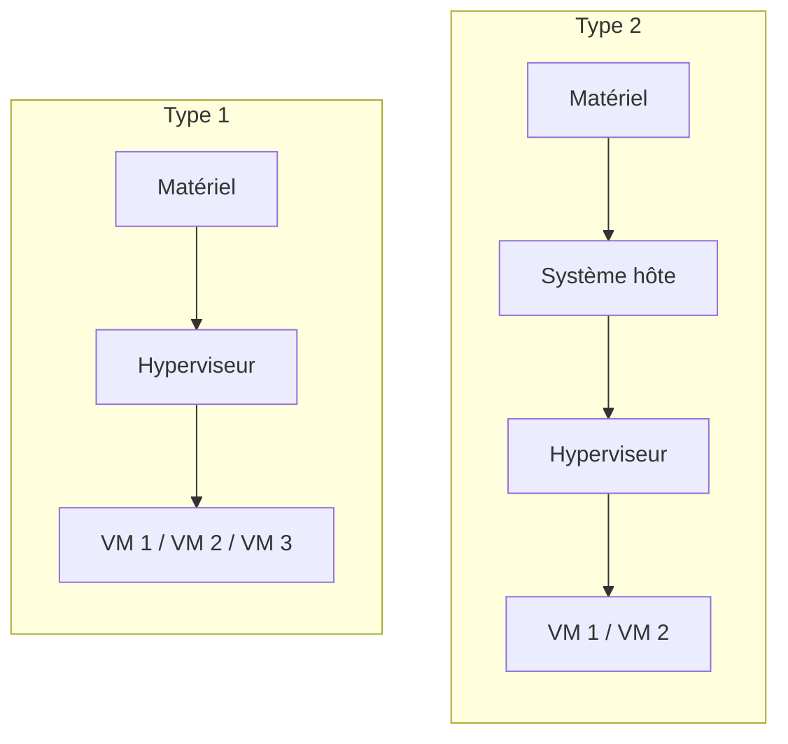

# Cours – La virtualisation : machine virtuelle et hyperviseur

*BTS SIO SISR 1re année – S06 – à lire avec le [TP](02-tp.md)*

## À la fin de ce cours, tu sauras

- [ ] définir **machine virtuelle**, **hyperviseur** et **virtualisation** ;
- [ ] dire **d'où viennent les ressources** d'une VM ;
- [ ] distinguer **virtualisation**, **émulation** et **conteneurisation** ;
- [ ] distinguer un hyperviseur de **type 1** et de **type 2**, et justifier le choix selon le contexte ;
- [ ] citer les **deux façons** de créer une VM et les formats de fichiers associés.

---

## 1. La machine virtuelle

Une **machine virtuelle** (VM) est un **ordinateur simulé à l'intérieur d'un autre ordinateur**. Elle n'existe pas matériellement : c'est un environnement logiciel qui imite le fonctionnement d'un vrai ordinateur.

Toute machine, physique ou virtuelle, a besoin de quatre ressources :

| Ressource | Rôle |
|---|---|
| Processeur (CPU) | exécute les instructions |
| Mémoire vive (RAM) | stocke ce qui est en cours d'utilisation |
| Stockage (disque ou SSD) | conserve les données |
| Réseau | permet de communiquer (souvent nécessaire) |

**D'où viennent ces ressources ?** Une VM n'a aucun composant à elle : elle utilise les ressources de la **machine hôte**, l'ordinateur sur lequel elle est installée. Les systèmes qui tournent dans les VM sont appelés **systèmes invités**.

> [!NOTE]
> Une machine hôte n'utilise pas 100 % de sa puissance en permanence : elle peut en « prêter » une partie à une ou plusieurs VM.

**Je vérifie.** Si ton poste a 16 Go de mémoire et que tu lances une VM avec 4 Go, combien reste-t-il à l'hôte pour lui-même et ses applications ?

Voir la réponse

Il reste au plus 12 Go à l'hôte : la mémoire donnée à la VM est prélevée sur celle de l'hôte tant que la VM est allumée. Il faut aussi laisser de quoi faire tourner l'hôte lui-même.

## 2. L'hyperviseur

Un système d'exploitation (Windows, Linux, macOS) ne sait pas, à lui seul, partager les ressources physiques avec d'autres systèmes. C'est le rôle de l'**hyperviseur**, un logiciel spécialisé qui **gère, répartit et isole** les ressources entre plusieurs machines virtuelles.

Il a deux rôles :

1. **créer des ressources virtuelles** propres à chaque VM : chaque VM croit disposer de son propre processeur, disque, carte réseau ;
2. **répartir les ressources physiques** entre les VM, dans les limites définies pour chacune.

La **virtualisation** est la technique qui permet de faire fonctionner plusieurs systèmes isolés sur une même machine physique.

## 3. Virtualisation, émulation, conteneurisation

### Émulation ou virtualisation ?

| | Principe | Exemple | Performance |
|---|---|---|---|
| **Émulation** | imite le comportement d'un système **différent** ; chaque instruction est traduite | jouer à un jeu de console ancienne sur un PC | plus lente |
| **Virtualisation** | fait fonctionner un système sur la **même architecture** matérielle (x86 sur x86) | installer Debian sur un PC Windows | plus rapide |

La virtualisation est plus rapide car aucune instruction n'est traduite : l'hôte et l'invité « parlent la même langue ».

### Machine virtuelle ou conteneur ?

Un **conteneur** (Docker, LXC) est un environnement logiciel isolé qui **partage le noyau** de la machine hôte : il n'a pas son propre système d'exploitation.

| Machine virtuelle | Conteneur |
|---|---|
| Chaque VM a **son propre système** | Les conteneurs **partagent le même noyau** |
| Isolation forte (matérielle) | Isolation logicielle |
| Plus lourde | Très légère |
| VirtualBox, VMware | Docker, LXC |

Conséquence : un hôte Linux peut exécuter des conteneurs de différentes distributions Linux (même noyau), mais pas des conteneurs Windows. Les conteneurs seront abordés en S11.

**Je vérifie.** Pourquoi ne peut-on pas faire tourner un conteneur Windows sur un hôte Debian ?

Voir la réponse

Un conteneur partage le noyau de l'hôte. Le noyau Linux de l'hôte ne peut pas faire fonctionner un programme conçu pour le noyau Windows.

## 4. Les deux types d'hyperviseurs

| | Type 2 (hébergé) | Type 1 (natif, « bare metal ») |
|---|---|---|
| **Installation** | sur un système d'exploitation existant, comme une application | directement sur le matériel, sans système intermédiaire |
| **Usage typique** | tests, formation, développement, quelques machines | production, serveurs, centres de données |
| **Exemples** | Oracle VirtualBox, VMware Workstation, VMware Fusion, Parallels Desktop, UTM | VMware ESXi, Microsoft Hyper-V, KVM, Xen |

### Type 2 : accessible, mais sans priorité

L'hyperviseur de type 2 s'installe comme n'importe quelle application. Il n'a **aucune priorité** sur les ressources : si une application de l'hôte consomme presque tout le processeur, l'hyperviseur doit se contenter du reste. Il convient pour **quelques machines**, en test ou en formation, pas pour héberger des serveurs en production.

Pour améliorer les performances : fermer les applications inutiles avant de lancer les VM, et surveiller la consommation dans le gestionnaire de tâches.

### Type 1 : la virtualisation professionnelle

L'hyperviseur de type 1 s'installe **directement sur le matériel** (l'installation d'ESXi, par exemple, efface le disque). Il accède directement aux ressources : meilleures performances et fiabilité accrue, donc davantage de VM hébergées. Il demande des serveurs robustes, et la licence est souvent coûteuse (selon le produit).

Les entreprises l'utilisent pour :

- réduire les coûts matériels (plusieurs serveurs sur une seule machine physique) ;
- améliorer la disponibilité des services ;
- ajuster la charge ;
- faciliter les sauvegardes et les migrations de VM ;
- créer des environnements de préproduction.

**Je vérifie.** Une PME veut héberger dix serveurs virtuels en production. Type 1 ou type 2 ? Pourquoi ?

Voir la réponse

Type 1 : en production on veut des performances, de la fiabilité et la priorité sur les ressources. Un type 2 dépendrait d'un système hôte généraliste et partagerait ses ressources avec d'autres applications.

## 5. Créer une machine virtuelle

Avant de créer une VM, il faut que le processeur prenne en charge la **virtualisation matérielle** : **VT-x** (Intel) ou **AMD-V** (AMD). Elle s'active, si besoin, dans le BIOS/UEFI. Sans elle, ou si elle est désactivée, les performances sont moindres.

### Deux façons d'obtenir une VM

1. **Créer une VM « nue »** : on choisit les paramètres (mémoire, processeurs, disque), puis on installe un système depuis un fichier **ISO**.
2. **Importer une VM préconfigurée** : un fichier **OVA** ou **OVF** contient déjà un système installé.

> [!WARNING]
> Une VM téléchargée sur Internet peut contenir des virus ou des scripts cachés. On ne télécharge que depuis des **sites officiels**.

### Les fichiers à connaître

| Fichier | Contenu |
|---|---|
| **ISO** | image d'un disque optique : sert à **installer** un système |
| **OVF** | uniquement la **description** de la VM ; il faut lui associer un fichier disque |
| **OVA** | un **paquet** : description de la VM **et** son disque (OVA = OVF + disque) |
| **VDI** | disque virtuel de VirtualBox |
| **VMDK** | disque virtuel historique de VMware |
| **VHD / VHDX** | disque virtuel historique de Microsoft (Hyper-V) |
| **QCOW2, IMG** | disques utilisés avec QEMU et UTM (Linux, Mac) |

Un fichier de disque virtuel ne contient que les **données du disque** de la VM, pas sa configuration.

**Je vérifie.** Quelle différence y a-t-il entre un fichier OVF et un fichier OVA ?

Voir la réponse

L'OVF ne décrit que la configuration de la VM et doit être accompagné d'un fichier disque. L'OVA regroupe en un seul fichier la description et le disque.

