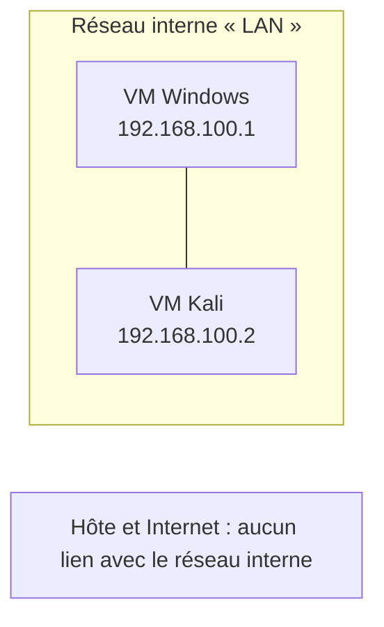
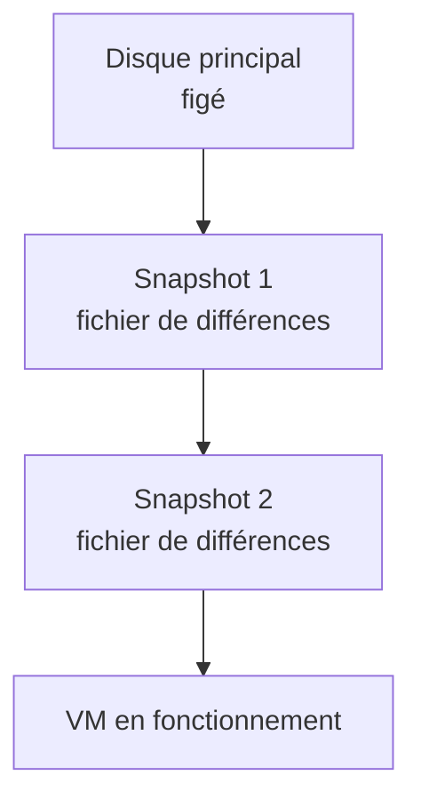

# Cours – Virtualisation avancée : réseau, snapshots et Guest Additions

*BTS SIO SISR 1re année – S07 – à lire avec le [TP](02-tp.md)*

## À la fin de ce cours, tu sauras

- [ ] décrire les **cinq modes réseau** de VirtualBox et choisir le bon selon le besoin ;
- [ ] configurer une **adresse IP manuelle** et tester avec **`ping`** ;
- [ ] expliquer ce qu'est un **snapshot**, une **chaîne de disques** et pourquoi ce n'est **pas une sauvegarde** ;
- [ ] dire à quoi servent les **Guest Additions** ;
- [ ] distinguer un disque virtuel **dynamique** d'un disque **fixe**.

---

## 1. Les modes réseau de VirtualBox

À sa création, une VM reçoit une **carte réseau virtuelle**. Le **mode d'accès** de cette carte décide comment la VM obtient son adresse, à quel réseau elle appartient et avec qui elle peut communiquer.

| Mode | Adresse IP automatique (DHCP) | Entre VM | Internet | Avec l'hôte | Usage typique |
|---|---|---|---|---|---|
| **NAT** | oui | non | oui | non (d'après la trace du cours, à vérifier) | une VM isolée qui télécharge, met à jour, navigue |
| **Réseau NAT** | oui | oui | oui | non | plusieurs VM qui se parlent et sortent sur Internet |
| **Accès par pont** | oui, si un serveur DHCP existe sur le réseau | oui | oui | oui | une VM visible sur le réseau comme une machine physique (serveur web, FTP, DHCP, DNS) |
| **Réseau interne** | **non** (adresse manuelle) | oui | non | non | réseau isolé pour des tests |
| **Réseau privé hôte** | oui | oui | non | oui | tester la communication entre l'hôte et une VM |

> [!NOTE]
> Ce tableau vient de la trace écrite du cours. Les cases « avec l'hôte » du mode NAT dépendent de la version de VirtualBox et de la cible visée : **c'est justement ce que tu vérifies en TP**.

### NAT

La VM utilise la connexion de l'hôte grâce à une **traduction d'adresse** (NAT), comme une box Internet. Elle n'a pas d'adresse visible sur le réseau local : par défaut, VirtualBox lui attribue une adresse du type `10.0.2.15`. Comme chaque VM est derrière son **propre** NAT, plusieurs VM peuvent avoir cette même adresse sans conflit : elles sont sur des **réseaux distincts**, donc **ne se voient pas**.

- Avantage : Internet tout de suite, sans configuration.
- Limite : pas de communication directe entre VM.

### Réseau NAT

Extension du NAT : les VM d'un **même réseau NAT** partagent un réseau privé, **communiquent entre elles** et sortent sur Internet par la connexion de l'hôte. Ce réseau doit être créé dans les paramètres de VirtualBox.

### Accès par pont

La carte virtuelle est reliée directement à la **carte physique** de l'hôte : la VM est une machine à part entière du réseau local, avec sa propre adresse (fournie par le DHCP du réseau, s'il y en a un).

- Avantage : idéal pour tester des serveurs accessibles depuis l'extérieur.
- Risques : moins sûr (la VM est **exposée sur le réseau réel**) ; certains réseaux **refusent** de donner une adresse à une VM. Si le DHCP refuse, on peut configurer une **adresse IP statique**.

### Réseau interne

VirtualBox crée un réseau **totalement isolé**, identifié par un **nom**. Toutes les VM dont la carte porte **le même nom** communiquent entre elles ; une VM avec un autre nom est sur un autre réseau. Rien ne distribue d'adresses : il faut **configurer l'IP à la main**.

### Réseau privé hôte

Un commutateur virtuel privé relie l'**hôte** et les VM : ils se parlent (réseau souvent en `192.168.56.0/24`, hôte en `192.168.56.1`), mais la VM n'a **pas d'accès Internet**.

> [!TIP]
> Une VM peut avoir **plusieurs cartes réseau**, chacune dans un mode différent. Un serveur web peut par exemple avoir une carte en « Réseau interne » (vers la base de données) et une en « Accès par pont » (vers les utilisateurs).

### Options avancées d'une carte

| Option | Rôle |
|---|---|
| Type de carte | modèle de carte virtuelle vu par le système invité |
| Mode promiscuité | permet de « voir » tout le trafic : utile pour l'analyse avec Wireshark |
| Adresse MAC | identifiant de la carte virtuelle, modifiable |

### À retenir pour les tests

> [!IMPORTANT]
> **Après chaque changement de mode** dans VirtualBox, il faut **désactiver puis réactiver** la carte réseau dans le **système de la VM** pour qu'elle relance sa configuration réseau.

- `ping adresse` teste la communication. Le **pare-feu** de Windows bloque en général les `ping` entrants : un `ping` sans réponse ne prouve **pas** qu'il n'y a pas de liaison. Vérifie avant de conclure.
- `ipconfig` (Windows) et `ip a` (Linux ; l'ancienne commande `ifconfig` existe encore sur certains systèmes) affichent la configuration réseau.

**Je vérifie.** Deux VM sont en mode **NAT** et ont toutes deux l'adresse `10.0.2.15`. Pourquoi n'y a-t-il pas de conflit d'adresse ?

Voir la réponse

Chaque VM est derrière son propre NAT : elles sont sur des réseaux distincts, même si l'adresse est identique. C'est aussi pour cela qu'elles ne peuvent pas se joindre.

**Je vérifie.** Quel mode choisir pour simuler un réseau d'entreprise fermé de trois VM, sans aucun lien avec le réseau du lycée ?

Voir la réponse

Le **réseau interne** : les trois VM portent le même nom de réseau et s'adressent à la main ; rien ne sort, rien n'entre.

## 2. Les snapshots

Un **snapshot** (instantané) est une **photographie de l'état d'une VM** à un instant donné : disque virtuel, mémoire, configuration matérielle, paramètres réseau. En quelques secondes, on peut revenir à cet état.

### À quoi ça sert

| Usage | Exemple |
|---|---|
| **Tester sans risque** | snapshot avant une mise à jour, une installation ou un changement de réglage réseau ; on revient en arrière si ça casse |
| **Garder un état stable** | système fraîchement installé, mise à jour validée, environnement de TP prêt |
| **Expérimenter** | casser, tester, recommencer sans réinstaller |
| **Accélérer un projet** | snapshot « système + Apache », puis « système + Apache + MariaDB » |

Le nom change selon l'hyperviseur : *snapshot* (VirtualBox, VMware, Proxmox/KVM, XenServer), *checkpoint* (Hyper-V).

### La chaîne de disques (disk chain)

Quand on crée un snapshot, l'hyperviseur **ne modifie plus le disque principal** : il crée un **fichier de différences** où vont toutes les nouvelles écritures.

Plus un snapshot reste actif longtemps, plus le fichier de différences **grossit**.

### Pourquoi ce n'est pas une sauvegarde

Un snapshot dépend du disque principal et des fichiers de différences, qui sont **au même endroit**. Si le stockage tombe en panne, **tout** est perdu, snapshot compris. Une sauvegarde est une **copie indépendante**, conservée ailleurs.

### Les risques d'une chaîne trop longue

| Risque | Pourquoi |
|---|---|
| **Performances dégradées** | chaque lecture passe par le disque principal puis par les fichiers de différences |
| **Espace disque** | les fichiers de différences peuvent devenir très volumineux ; un stockage plein bloque la VM et peut corrompre des données |
| **Chaîne fragile** | un seul fichier endommagé peut rendre toute la VM inutilisable ; une fusion (*merge*) peut échouer |
| **Sauvegardes compliquées** | beaucoup d'outils refusent de sauvegarder une VM qui a un snapshot actif |

> [!WARNING]
> Ne jamais laisser tourner longtemps une VM **critique** (annuaire, base de données, serveur de fichiers) avec un snapshot actif.

**Je vérifie.** Pourquoi un snapshot ne remplace-t-il jamais une sauvegarde ?

Voir la réponse

Il dépend des fichiers du disque d'origine, stockés au même endroit : une panne du stockage détruit à la fois la VM et ses snapshots. Une sauvegarde est une copie indépendante, sur un autre support ou un autre site.

## 3. Les Guest Additions

Les **Guest Additions** sont un ensemble de pilotes et d'outils installés **dans le système invité** (Windows, Linux) pour mieux l'intégrer à l'hôte. Elles apportent notamment :

- le **copier-coller** et le **glisser-déposer** entre l'hôte et la VM ;
- les **dossiers partagés** ;
- le redimensionnement de l'écran et une meilleure gestion de la souris.

On les installe depuis le menu **Périphériques** de VirtualBox (insérer l'image CD des Additions invité), puis on lance l'installation dans la VM.

## 4. Le stockage d'une VM

| Type de disque virtuel | Principe | Avantage | Inconvénient |
|---|---|---|---|
| **Allocation dynamique** | le fichier **grossit** à mesure que la VM écrit | peu de place prise au départ | peut ralentir en grossissant ; la place doit exister sur l'hôte le moment venu |
| **Taille fixe** | tout l'espace est **réservé** à la création | accès plus prévisible | occupe toute la taille tout de suite |

Les formats de fichiers de disque (VDI, VMDK, VHD…) sont décrits dans le [cours S06](../S06-virtualisation-premieres-vm/01-cours.md).

## 5. Une situation professionnelle : migrer un serveur vers la virtualisation

**Contexte.** Une PME de 80 salariés a **un seul serveur physique** Windows Server 2016 (partage de fichiers, imprimante réseau, DHCP). Le matériel a 7 ans et devient instable. Il faut moderniser sans interrompre l'activité, et prévoir un serveur de sauvegarde et un serveur de test.

**Problème.** Un seul serveur est un **point de défaillance unique** (SPOF) : s'il tombe, toute l'entreprise est paralysée.

**Solution envisagée.** Un serveur neuf avec un **hyperviseur de type 1** (par exemple ESXi, Hyper-V ou Proxmox) et plusieurs VM : annuaire et DNS, serveur de fichiers, serveur d'impression, préproduction. Bénéfices : isolation des rôles, snapshots avant les mises à jour critiques, sauvegardes et migrations facilitées, économie de matériel, évolution progressive.

**Je vérifie.** La virtualisation supprime-t-elle le point de défaillance unique dans cet exemple ?

Voir la réponse

Pas à elle seule : avec **un seul** serveur physique, si la machine tombe, toutes les VM tombent. La haute disponibilité n'apparaît qu'avec **un second serveur** physique.

