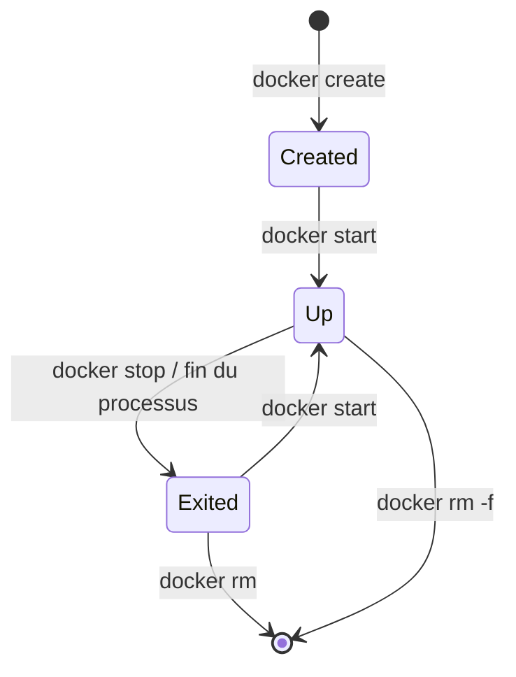

# Cours – Les conteneurs

*BTS SIO SISR 1re année – S11 – à lire avant le [TP](02-tp.md)*

## À la fin de ce cours, tu sauras

- [ ] expliquer ce qui distingue un **conteneur** d'une **machine virtuelle** ;
- [ ] distinguer **image**, **conteneur**, **registre** et **tag** ;
- [ ] utiliser les commandes du **cycle de vie** d'un conteneur ;
- [ ] **publier un port** et **configurer** un conteneur avec `-e` ;
- [ ] **conserver des données** avec un **volume** ;
- [ ] **relier** des conteneurs par un **réseau** et les joindre par leur **nom** ;
- [ ] **diagnostiquer** un conteneur qui s'arrête.

---

## 1. Pourquoi des conteneurs ?

Installer une application (serveur Web, base de données…) sur un serveur demande de régler des **dépendances** : versions de bibliothèques, fichiers de configuration, ports. « Ça marche sur ma machine » ne garantit pas que ça marche sur la machine voisine. Un **conteneur** emballe l'application **avec ce dont elle a besoin** et la fait tourner **isolée** du reste du système, de façon **reproductible**.

## 2. Machine virtuelle ou conteneur ?

| | Machine virtuelle (S06, S07) | Conteneur |
|---|---|---|
| **Ce qui est isolé** | Une machine complète, avec son **propre noyau** | Un ou plusieurs **processus**, avec leur système de fichiers, leur réseau |
| **Noyau** | Un noyau par VM | **Le noyau de l'hôte, partagé** |
| **Poids** | De l'ordre de plusieurs Gio | Souvent quelques dizaines à quelques centaines de Mio |
| **Démarrage** | Dizaines de secondes à minutes (démarrage d'un système) | Environ une seconde (démarrage d'un processus) |
| **Isolation** | Forte (matériel virtualisé) | Plus faible (noyau commun) |
| **Usage typique** | Un système d'exploitation complet, un autre OS | Une application et ses dépendances |

> [!NOTE]
> **Un conteneur « Linux » nécessite un noyau Linux.** Sous Windows ou macOS, les outils comme Docker Desktop font tourner une **petite machine virtuelle Linux** qui héberge les conteneurs. Dans DockerLab, tu peux le constater : le noyau affiché par `uname -r` dans un conteneur est celui de l'hôte.

**Ce ne sont pas des concurrents.** On fait souvent tourner des conteneurs **dans** des machines virtuelles : la VM isole et se gère comme un serveur, les conteneurs découpent l'application.

## 3. Image, conteneur, registre

| Notion | Définition | Analogie |
|---|---|---|
| **Image** | Modèle **en lecture seule**, empilement de **couches** (système de base, bibliothèques, application) | La recette ou la classe |
| **Conteneur** | **Instance** d'une image en cours d'exécution (ou arrêtée), avec une fine couche d'écriture | Le gâteau ou l'objet |
| **Registre** | Serveur qui héberge des images (par exemple Docker Hub) | La bibliothèque |
| **Tag** | Étiquette de version d'une image : `nginx:1.27` ; sans tag : `latest` | Le numéro de version |

Avec une même image, on crée autant de conteneurs qu'on veut.

> [!WARNING]
> **`latest` n'est pas « la dernière version stable ».** C'est un tag comme un autre, qui change dans le temps. En production, on **fixe la version** (`nginx:1.27`) pour obtenir le même résultat à chaque déploiement.

## 4. Le cycle de vie d'un conteneur

| Commande | Effet |
|---|---|
| `docker run IMAGE` | **Télécharge** l'image si besoin, **crée** un conteneur et le **démarre** |
| `docker run -d --name NOM IMAGE` | Idem, **en arrière-plan** (`-d`), avec un **nom** choisi |
| `docker ps` · `docker ps -a` | Conteneurs en cours · **tous** les conteneurs (arrêtés compris) |
| `docker logs NOM` | Affiche ce que le conteneur a écrit sur sa sortie |
| `docker stop NOM` · `docker start NOM` | Arrêter · redémarrer |
| `docker rm NOM` · `docker rm -f NOM` | Supprimer · forcer (même en cours) |
| `docker exec NOM COMMANDE` | Lancer une commande dans un conteneur **déjà en cours** |

Un conteneur vit **tant que son processus principal tourne**. S'il se termine, le conteneur passe à l'état *Exited* ; il n'est pas supprimé pour autant. Un **nom** de conteneur est **unique**.

`docker stop` envoie d'abord un signal d'arrêt propre (SIGTERM), puis un arrêt brutal (SIGKILL) au bout de **10 secondes** si le processus n'obéit pas.

## 5. Publier un port, configurer avec des variables

Un conteneur a **sa propre pile réseau**. Un serveur Web qui écoute sur le port 80 **dans** le conteneur n'est pas joignable depuis l'hôte tant qu'on n'a pas **publié** le port :

> `-p PORT_HÔTE:PORT_CONTENEUR` : `-p 8080:80` envoie ce qui arrive sur le port **8080 de l'hôte** vers le port **80 du conteneur**.

Un port d'hôte ne peut servir qu'**un seul** conteneur à la fois (sinon : « port is already allocated »). Deux conteneurs peuvent en revanche écouter tous les deux sur leur port 80 interne, publiés sur 8080 et 8081.

Une image est **générique** : on l'adapte au démarrage avec des **variables d'environnement** (`-e NOM=valeur`). Exemple : l'image `postgres` exige `POSTGRES_PASSWORD` ; sans elle, le conteneur refuse de démarrer. On ne peut **pas** changer une variable sur un conteneur existant : on le **recrée**.

> [!WARNING]
> **Une variable d'environnement n'est pas un coffre-fort.** Elle est visible avec `docker inspect`. On évite de coller de vrais mots de passe dans des commandes partagées ; en production, on utilise des mécanismes dédiés aux secrets (hors programme de cette séance).

## 6. Les volumes : garder ses données

Tout ce qu'un conteneur écrit dans son système de fichiers va dans sa couche d'écriture, **détruite avec le conteneur**. C'est voulu : on peut jeter et recréer un conteneur à volonté. Pour une base de données ou un site modifiable, il faut des données qui **survivent**.

Un **volume** est un espace de stockage géré par Docker, **indépendant des conteneurs** :

> `-v NOM_DU_VOLUME:/chemin/dans/le/conteneur`

| Type | Exemple | Remarque |
|---|---|---|
| Volume **nommé** | `-v jc-db:/var/lib/postgresql/data` | Créé volontairement, nom lisible ; **à privilégier** |
| Volume **anonyme** | créé automatiquement quand l'image en déclare un | Nom aléatoire ; difficile à retrouver |
| **Bind mount** | `-v /dossier/hôte:/dossier/conteneur` | Monte un dossier de l'hôte (vu dans DockerLab) |

> [!NOTE]
> **Un volume n'est pas une sauvegarde.** Il survit à la suppression d'un conteneur, mais pas à la perte du serveur ni à une erreur de suppression du volume. La sauvegarde est vue en S20.

## 7. Les réseaux

Docker crée un réseau virtuel par défaut, **bridge** : les conteneurs s'y voient par **adresse IP**, mais **pas par nom**. Un **réseau défini par l'utilisateur** ajoute un **DNS interne** : on joint un conteneur par son **nom**, quelle que soit son adresse. Des conteneurs sur des réseaux différents sont **isolés** les uns des autres.

| Commande | Effet |
|---|---|
| `docker network create NOM` | Crée un réseau |
| `docker run --network NOM …` | Lance un conteneur directement sur ce réseau |
| `docker network connect NOM CONTENEUR` | Branche un conteneur existant |
| `docker network inspect NOM` | Montre le sous-réseau et les conteneurs branchés |

**Architecture type : un site + une base.** Le site est **publié** (accessible à l'extérieur) ; la base n'est **pas publiée** : elle n'est joignable **que** par le site, à travers le réseau. C'est un principe de sécurité : on n'expose que ce qui doit l'être.

## 8. Diagnostiquer un conteneur

Devant un conteneur en panne, toujours le même fil :

1. **L'état** : `docker ps -a` ;
2. **Les journaux** : `docker logs NOM` (le message d'erreur y est presque toujours) ;
3. **La configuration** : `docker inspect NOM` (variables, ports, volumes, réseaux).

Le **code de sortie** aide : **0** = fin normale ; **1** = erreur de l'application ; **125 à 127** = Docker ou la commande n'a pas pu démarrer ; **137** = tué (SIGKILL) ; **143** = arrêté proprement (SIGTERM).

## 9. DockerLab : ce qu'il est, ce qu'il n'est pas

**DockerLab** est un **simulateur** qui tourne dans ton navigateur : un terminal, une vue graphique des conteneurs, des TP guidés avec vérification automatique. **Aucun vrai programme n'est exécuté** : les services sont simulés. Il sert à **apprendre sans rien installer et sans rien casser**. Quelques commandes ou messages rares peuvent différer d'un vrai Docker : en cas de doute, la référence est la documentation officielle de Docker.

---

## À retenir

- Un **conteneur** partage le **noyau** de l'hôte : plus léger et plus rapide qu'une VM, mais moins isolé.
- **Image** = modèle ; **conteneur** = instance ; un nom est unique ; on **fixe la version** de l'image.
- `run` = `pull` si besoin + `create` + `start` ; un conteneur vit tant que son processus tourne.
- `-p hôte:conteneur` publie un port ; `-e NOM=valeur` configure ; pour changer, on recrée.
- Les données d'un conteneur sont **éphémères** : **volume nommé** pour les garder ; un volume n'est **pas** une sauvegarde.
- Réseau utilisateur = **DNS interne** (joindre par le nom) ; on **n'expose** que ce qui doit l'être.
- Diagnostic : **ps -a → logs → inspect**.
