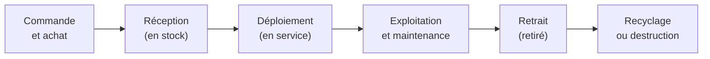

# Cours – Patrimoine informatique et inventaire

*BTS SIO SISR 1re année – S12 – à lire avant le [TP](02-tp.md)*

> [!NOTE] Ce que tu dois savoir déjà
> - **Prérequis :** fiche d'identité d'un poste (S02) ; terminal Linux (S08 à S10).
> - **Mots déjà vus :** inventaire d'un poste, composants.
> - **Expliqués dans ce cours :** patrimoine, inventaire, fiche d'inventaire, agent, méthodes manuelle et automatisée, qualité des données, données personnelles et RGPD.

## À la fin de ce cours, tu sauras

- [ ] définir le **patrimoine informatique** et un **élément de configuration** (CI) ;
- [ ] dire **pourquoi** on inventorie et **quoi** inventorier ;
- [ ] décrire le **cycle de vie** d'un équipement ;
- [ ] comparer inventaire **manuel** et **automatisé** (avec un calcul) ;
- [ ] repérer les **défauts de qualité** d'un inventaire ;
- [ ] expliquer les **enjeux de données personnelles** d'un inventaire ;
- [ ] citer des **outils** d'inventaire et leurs principes (agent, sans agent).

---

## 1. Le patrimoine informatique

Le **patrimoine informatique** (ou **parc**) est l'ensemble des **ressources numériques** que possède, loue ou utilise une organisation :

| Catégorie | Exemples |
|---|---|
| **Matériels** | Postes, portables, serveurs, écrans, imprimantes, switchs, routeurs, téléphones |
| **Logiciels** | Systèmes d'exploitation, applications, services hébergés |
| **Licences et contrats** | Licences logicielles, garanties, maintenance, abonnements |
| **Services** | Messagerie, partage de fichiers, accès à distance |
| **Personnes et lieux** | Utilisateurs, services, bureaux, sites |

Un **élément de configuration** (*Configuration Item*, **CI**) est tout élément qu'on **gère** individuellement et dont on veut connaître la description et les liens. Une base qui rassemble les CI et leurs relations s'appelle une **CMDB** (*Configuration Management Database*, base de données de gestion des configurations). Les outils comme GLPI (S14) jouent ce rôle.

## 2. Pourquoi inventorier ?

| Besoin | Ce que l'inventaire permet |
|---|---|
| **Support** | Savoir quelle machine, quelle version, quel utilisateur, avant d'intervenir |
| **Sécurité** | Retrouver les machines à mettre à jour ou à isoler (par exemple une version de système qui n'est plus supportée) |
| **Coûts** | Planifier les renouvellements, éviter les achats inutiles |
| **Conformité** | Prouver qu'on a les **licences** des logiciels utilisés |
| **Pilotage** | Disposer de chiffres : nombre de postes par service, âge moyen du parc |

Sans inventaire fiable, une panne, une faille ou un contrôle de licences oblige à **chercher** avant d'agir.

## 3. Que décrit une fiche d'inventaire ?

| Famille d'attributs | Exemples |
|---|---|
| **Identification** | **Identifiant d'inventaire unique** (étiquette collée sur le matériel), numéro de série, nom de la machine |
| **Description** | Type, marque, modèle, système, caractéristiques techniques |
| **Affectation** | Utilisateur, service, **localisation** |
| **Achat et contrat** | Date d'achat, fournisseur, durée de garantie |
| **État** | En stock, en service, en panne, retiré |

**Identifiant unique.** Chaque équipement reçoit **un** identifiant qui ne change jamais (par exemple `INV-0042`). Le **numéro de série** est donné par le constructeur ; le **nom** d'une machine peut changer ; l'**adresse IP** aussi : seul l'identifiant d'inventaire est stable.

**Cycle de vie d'un équipement :**

Un équipement change d'**état** au fil de ce cycle : l'inventaire doit le **suivre**, sinon il vieillit.

## 4. Inventaire manuel ou automatisé

**Manuel :** une personne relève chaque équipement et remplit une fiche (tableur, formulaire). Pour **un** poste, c'est instructif ; pour 200, c'est un mois de travail.

**Automatisé :** un programme (un **agent**) installé sur chaque machine collecte les informations et les envoie à un serveur à intervalles réguliers.

| Critère | Manuel | Automatisé |
|---|---|---|
| **Coût de départ** | Faible | Installation du serveur et des agents |
| **Coût par poste** | Élevé (temps humain) | Très faible |
| **Fraîcheur** | Périme dès l'écriture | Mise à jour régulière |
| **Exhaustivité** | Dépend du soin, oublis fréquents | Voit ce qui a un agent ; détecte des équipements inconnus avec un scan réseau |
| **Traçabilité** | Faible | Historique des changements |
| **Erreurs** | Fautes de frappe, formats variables | Données homogènes |

**Ordre de grandeur.** Temps manuel : 45 minutes par poste.

| Parc | Temps manuel (45 min par poste) |
|---|---|
| 1 poste | 45 min |
| 50 postes | 50 × 45 min = 2 250 min = **37 h 30** |
| 200 postes | 200 × 45 min = 9 000 min = **150 h** |

Le temps d'un déploiement automatisé dépend de l'organisation (déploiement par script, par stratégie de groupe, par un outil de déploiement) : les chiffres couramment cités sont des **estimations**, à discuter et à remplacer par des mesures sur son propre parc.

**Quatre façons d'alimenter un parc.** Un outil de gestion de parc est **vide** tant qu'on ne l'a pas rempli. Il peut l'être par : la **saisie manuelle** (précise mais lente et périssable) ; l'**import** d'un fichier (rapide, mais reprend les défauts du fichier) ; la **découverte réseau** (détecte ce qui répond sur le réseau, sans le détail) ; l'**agent** (détail matériel et logiciels, mais seulement là où il est installé). Ces modes se **complètent**.

> [!TIP]
> **Dans InfraLab** (TP, partie D) : le TP 1 te fait constater un Parc vide puis le remplir par découverte, le TP 4 complète une fiche (numéro d'inventaire, numéro de série, garantie) et le TP 9 traite une imprimante sans agent. Tu vois **ce que chaque mode sait et ne sait pas**.

**Agent ou sans agent ?** Un **agent** est un petit programme sur chaque poste. Une méthode **sans agent** (*agentless*) interroge à distance par des protocoles réseau comme **SNMP** (équipements réseau, imprimantes) ou **WMI** (Windows) notion technique. Les deux se combinent : agent pour les postes, SNMP pour les imprimantes et les switchs.

## 5. La qualité des données

Un inventaire faux est **pire** qu'un inventaire absent : on s'y fie à tort. Les défauts classiques :

| Défaut | Exemple | Conséquence |
|---|---|---|
| **Doublon** | Même numéro de série sur deux lignes | Comptage faux, litige de garantie |
| **Champ vide** | Pas de numéro de série | Équipement non identifiable |
| **Formats différents** | `2024-02-13` et `13/02/2024` | Tri et calculs de dates faux |
| **Valeurs non normalisées** | « En service », « en service », « Actif » | Statistiques fausses |
| **Valeur incohérente** | Date d'achat dans le futur | Donnée suspecte |
| **Fiche périmée** | Poste retiré encore affecté à un utilisateur | Mauvaises décisions |

**Règles utiles** : un **dictionnaire de données** (liste des champs, format, valeurs permises), des **listes de choix** plutôt que du texte libre, un **contrôle** régulier (doublons, vides, incohérences), un **responsable** de l'inventaire.

## 6. Inventaire et données personnelles

Un inventaire relie des **machines** à des **personnes** (utilisateur, service). C'est donc, en partie, un **traitement de données à caractère personnel**, soumis au **RGPD** (règlement européen) et à la loi française. Principes à connaître :

| Principe | Application à l'inventaire |
|---|---|
| **Finalité** | On inventorie pour des raisons précises : support, sécurité, licences. Pas pour surveiller l'activité des personnes |
| **Minimisation** | On ne collecte que ce qui sert : pas de contenu de fichiers, pas d'historique de navigation |
| **Information** | Les utilisateurs sont **informés** (par exemple dans la **charte informatique** qu'ils signent) |
| **Sécurité** | Le serveur d'inventaire est protégé : authentification, accès restreint, chiffrement des échanges |
| **Durée** | On ne garde pas les données au-delà du nécessaire |

> [!WARNING]
> Ceci est un **rappel de principes**, pas un avis juridique. Pour un cas réel, on consulte le **délégué à la protection des données** (DPO) ou le référent de l'organisation.

## 7. Quelques outils d'inventaire

| Outil | Nature | Inventaire automatique | Tickets | Remarque |
|---|---|---|---|---|
| **GLPI** | Logiciel libre de gestion de parc et d'assistance | Oui, avec l'**agent GLPI** (inventaire natif) | Oui | Très répandu dans les organisations françaises ; vu en S13 et S14 |
| **OCS Inventory NG** | Logiciel libre d'inventaire | Oui (agent) | Non | Souvent associé à GLPI ; voir S13 (variante) |
| **Outils Microsoft** (Intune, Configuration Manager) | Gestion de parc Windows | Oui | Non (selon la solution) | Coût lié aux licences Microsoft |
| **Solutions commerciales d'inventaire** | Produits payants ou à version limitée | Oui, souvent sans agent | Variable | À étudier au cas par cas |
| **Plateformes de gestion de services en ligne** | Services hébergés | Oui | Oui | Coût élevé, hors périmètre |

> [!NOTE]
> Les **licences** et les **tarifs** évoluent : on les **vérifie** sur les sites des éditeurs avant de comparer (voir la page [Licences et crédits](../../ressources/licences.md)).

---

## À retenir

- Le **patrimoine** = matériels, logiciels, licences, services, personnes, lieux ; un **CI** est un élément géré individuellement ; la **CMDB** les rassemble.
- On inventorie pour le **support**, la **sécurité**, les **coûts**, la **conformité**, le **pilotage**.
- Une fiche a un **identifiant unique stable** ; l'équipement a un **cycle de vie** (achat → retrait) et un **état**.
- Manuel : 45 min × nombre de postes ; automatisé : **agent** (postes) + **SNMP / WMI** (réseau).
- Un inventaire faux est pire qu'aucun : **doublons**, **vides**, **formats**, **états** non normalisés, **fiches périmées**.
- Un inventaire touche aux **données personnelles** : **finalité, minimisation, information (charte), sécurité**.
