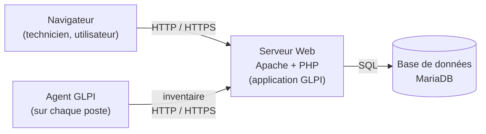

# Cours – GLPI et l'inventaire automatique

*BTS SIO SISR 1re année – S13 – à lire avant le [TP](02-tp.md)*

> [!NOTE] Ce que tu dois savoir déjà
> - **Prérequis :** virtualisation (S06, S07), terminal et paquets (S08 à S10), inventaire (S12).
> - **Mots déjà vus :** agent, inventaire, CMDB, paquet, VM, instantané.
> - **Expliqués dans ce cours :** GLPI, base de données, serveur web, agent GLPI, diagnostic d'un poste qui ne remonte pas.

## À la fin de ce cours, tu sauras

- [ ] décrire l'**architecture** de GLPI et ce qu'il faut installer ;
- [ ] expliquer le principe de l'**inventaire natif** et de l'**agent GLPI** ;
- [ ] décrire la procédure d'**installation** et les points de **sécurité** ;
- [ ] situer la variante **OCS Inventory NG** ;
- [ ] **diagnostiquer** un poste qui ne remonte pas.

---

## 1. GLPI : un outil de gestion de parc et d'assistance

**GLPI** (*Gestion libre de parc informatique*) est un logiciel libre qui rassemble, dans un seul outil :

- la **CMDB** : l'inventaire des équipements (ordinateurs, imprimantes, réseau, logiciels…) ;
- la **gestion des tickets** (incidents, demandes) : S15 ;
- la **base de connaissances**, les **licences**, les **contrats**.

Il est très répandu dans les organisations françaises. Son éditeur principal est la société Teclib' avec une communauté. **Vérifie la licence** et la version sur le site officiel du projet.

## 2. Architecture et installation

| Couche | Rôle | Paquets Debian (exemples) |
|---|---|---|
| **Serveur Web** | Reçoit les requêtes, exécute GLPI | `apache2` |
| **PHP** | Langage de GLPI, avec des **extensions** | `php`, `php-mysql`, `php-curl`, `php-gd`, `php-intl`, `php-xml`, `php-mbstring`, `php-zip`, `php-bz2`… |
| **Base de données** | Stocke tickets, actifs, utilisateurs | `mariadb-server` |
| **Application** | Fichiers de GLPI | archive téléchargée sur le site officiel du projet |

> [!NOTE]
> **Trois mots à connaître.** Un **serveur Web** est un programme qui envoie des pages aux navigateurs. Une **base de données** est un programme qui range et retrouve des informations organisées en tableaux (tickets, postes, utilisateurs). **PHP** est le langage dans lequel GLPI est écrit : le serveur Web l'exécute. Tu n'as pas à les programmer, seulement à les installer et à vérifier qu'ils fonctionnent.

Cet ensemble s'appelle une pile **LAMP** (Linux, Apache, MariaDB, PHP).

**Étapes générales** (la **documentation officielle** fait foi pour la version choisie) :

1. **Installer** Apache, PHP et ses extensions, MariaDB.
2. **Sécuriser MariaDB** (`mysql_secure_installation`), puis créer une **base** et un **utilisateur dédié** avec les droits sur cette seule base.
3. **Télécharger et extraire** GLPI, puis donner à Apache (utilisateur `www-data`) les droits sur les dossiers que GLPI modifie.
4. **Configurer Apache** : un hôte virtuel dont la racine est le dossier **public** de GLPI (versions récentes).
5. **Terminer par l'assistant web** : vérification des prérequis, connexion à la base, initialisation.
6. **Sécuriser** : changer les mots de passe des comptes créés par défaut ; suivre les avertissements affichés par GLPI.

> [!WARNING]
> **Les versions changent.** Les procédures trouvées sur Internet datent souvent d'une ancienne version de GLPI, de PHP ou de Debian. Avant d'exécuter une commande, **vérifie la date et la version** de la page et **compare avec la documentation officielle**.

### Sécurité de l'installation

| Risque | Mesure |
|---|---|
| Comptes d'exemple connus de tous (mot de passe identique au nom) | **Changer** ou **supprimer** les comptes créés par défaut dès la fin de l'installation |
| Base de données ouverte avec un mot de passe faible | `mysql_secure_installation`, mot de passe fort, utilisateur limité à **sa** base |
| Échanges en clair | **HTTPS** en production (certificat) ; HTTP toléré uniquement en **laboratoire isolé** |
| Serveur exposé | Pare-feu, mises à jour, accès restreint |

## 3. L'inventaire natif et l'agent GLPI

Depuis la **version 10**, GLPI sait **recevoir des inventaires directement** (inventaire natif), sans plugin pour l'inventaire de base. L'**agent GLPI** est le programme installé sur chaque poste qui :

1. **collecte** le matériel (processeur, mémoire, disques, cartes réseau, numéro de série…) et les **logiciels installés** ;
2. **envoie** le résultat au serveur GLPI sur le **réseau** ;
3. **recommence** à intervalles réguliers.

| Mode d'exécution | Principe |
|---|---|
| **Service** | Tourne en arrière-plan en permanence (le plus courant) |
| **Tâche planifiée** | Lancé toutes les X heures ou jours |
| **Manuel** | Lancé à la demande |

**Paramètres de l'installeur Windows** (documentation officielle de l'agent) :

| Paramètre | Rôle |
|---|---|
| `SERVER=URL` | Adresse du serveur GLPI (on peut en indiquer **plusieurs**, séparées par des virgules) |
| `TAG=étiquette` | Étiquette attachée au poste (groupe, site, classe) |
| `RUNNOW=1` | Lance un inventaire **tout de suite** après l'installation |
| `EXECMODE=1/2/3` | Service (défaut), tâche planifiée, manuel |
| `ADD_FIREWALL_EXCEPTION=1` | Ajoute l'agent aux exceptions du pare-feu Windows |

> [!NOTE]
> **L'inventaire doit être activé dans GLPI** (menu Administration, rubrique Inventaire, case à cocher) : sans cela, le serveur refuse les inventaires. L'intitulé exact du menu dépend de la version et de la langue : **vérifie-le sur ton instance**.

**Ce que l'inventaire natif ne fait pas seul.** Les fonctions avancées (découverte réseau, inventaire SNMP des imprimantes et switchs, déploiement de logiciels…) demandent le **plugin GLPI Inventory** (hors programme de cette séance).

## 4. Un poste ne remonte pas : méthode

| Étape | Question | Vérification |
|---|---|---|
| 1 | Le poste **joint-il** le serveur ? | `ping IP_SERVEUR` ; navigateur sur `http://IP_SERVEUR/` |
| 2 | L'**URL** donnée à l'agent est-elle la bonne ? | Relire la configuration de l'agent |
| 3 | L'**inventaire** est-il activé dans GLPI ? | Menu Administration › Inventaire |
| 4 | Un **pare-feu** bloque-t-il ? | Pare-feu du serveur et du poste |
| 5 | L'agent a-t-il **tourné** et que dit son **journal** ? | Journal de l'agent (sous Windows, dans le dossier d'installation, sous-dossier `logs`) |
| 6 | Le serveur a-t-il enregistré une **erreur** ? | Journaux de GLPI et d'Apache (`/var/log/apache2/`) |

On remonte la **chaîne** : réseau → URL → activation → agent → serveur.

## 5. Variante : OCS Inventory NG

**OCS Inventory NG** est un autre outil libre d'inventaire. Il se compose de :

| Composant | Rôle |
|---|---|
| **Serveur OCS** (Apache, Perl, base dédiée) | Reçoit et stocke les inventaires |
| **Console `ocsreports`** | Interface web d'OCS |
| **Agent OCS** | Collecte sur chaque poste |
| **Plugin « OCS Inventory NG » de GLPI** | Importe les ordinateurs d'OCS dans la CMDB de GLPI |

Avec OCS, on installe **deux serveurs** (OCS puis GLPI) et un plugin de liaison ; avec l'agent GLPI, **un seul** (GLPI) suffit. OCS reste très présent dans des organisations existantes : on peut le rencontrer en entreprise.

> [!NOTE]
> **Ne pas confondre.** Le **plugin OCS Inventory NG** (liaison OCS vers GLPI) et **FusionInventory** (un autre agent d'inventaire, dont l'agent GLPI est un successeur) sont des composants **différents**.

## 6. Des données de parc, donc des données personnelles

Rappel de S12 : l'inventaire relie des machines à des **utilisateurs**. Le serveur GLPI doit être **protégé** (mots de passe, HTTPS, accès restreint, sauvegardes) et l'usage **annoncé** dans la charte informatique.

---

## À retenir

- GLPI = **CMDB + tickets** ; pile **Apache + PHP + MariaDB** ; **base dédiée** avec utilisateur dédié.
- Installation : **composants → base → fichiers → Apache → assistant → sécurité**. La **doc officielle** fait foi ; les versions changent.
- **Inventaire natif** (GLPI ≥ 10) + **agent GLPI** : collecte → envoi → répétition. L'inventaire doit être **activé**.
- Poste absent : **réseau → URL → activation → agent → serveur**.
- OCS = variante à **deux serveurs** et un plugin de liaison.
- **Changer les comptes par défaut** ; **HTTPS** hors laboratoire.
