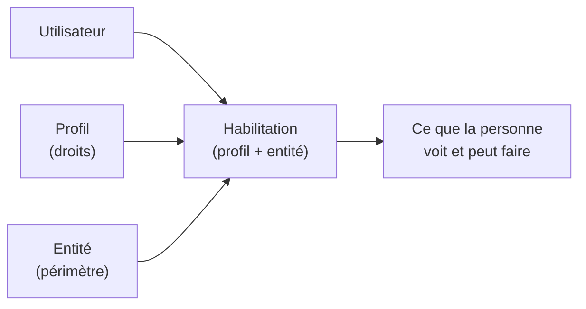

# Cours – Exploiter le parc dans GLPI

*BTS SIO SISR 1re année – S14 – à lire avant le [TP](02-tp.md)*

## À la fin de ce cours, tu sauras

- [ ] te **repérer** dans l'interface de GLPI et lire une fiche d'équipement ;
- [ ] expliquer ce qu'est un **élément de la CMDB** et en créer un à la main ;
- [ ] distinguer **entité**, **utilisateur**, **groupe**, **profil** ;
- [ ] expliquer le suivi des **logiciels** et des **licences** ;
- [ ] justifier la **sauvegarde** de la base et la protection des **données personnelles** ;
- [ ] lire un **rapport** et en tirer une décision.

> [!WARNING]
> **Les menus varient selon la version.** Les noms de menus cités ici sont ceux du support d'origine et de versions courantes de GLPI ; l'interface a été réorganisée entre versions. Si un chemin diffère, **cherche la fonction** (champ de recherche de l'interface, documentation officielle) et **note le chemin réel** dans ton compte rendu.

## 1. L'interface : où est quoi ?

GLPI regroupe ses fonctions en grandes familles. Les noms ci-dessous sont indicatifs.

| Famille | Contenu principal | Séance |
|---|---|---|
| **Accueil** | Tableau de bord : vue d'ensemble | S14, S15 |
| **Parc** | Ordinateurs, moniteurs, logiciels, matériel réseau, périphériques, imprimantes, téléphones | S13, S14 |
| **Assistance** | Tickets, problèmes, changements, planification | S15 |
| **Gestion** | Fournisseurs, contrats, documents, licences | S14 |
| **Outils** | Notes, tâches, rapports, base de connaissances | S14, S15 |
| **Administration** | Utilisateurs, groupes, entités, profils | S14 |
| **Configuration** | Listes déroulantes, règles, authentification, plugins | S14 |

**Lire une fiche d'équipement.** Une fiche d'ordinateur comporte plusieurs **onglets** : caractéristiques (nom, état, lieu, utilisateur, numéro de série), composants, logiciels, connexions réseau, **historique** (qui a modifié quoi et quand), tickets liés. L'**historique** est une preuve : il répond à « qui a changé cette valeur ? ».

## 2. La CMDB : ce qu'on y met

Rappel de [S12](../S12-patrimoine-inventaire/01-cours.md) : un **élément de configuration** (CI) est un élément qu'on gère parce que sa défaillance ou sa modification a un effet sur le service.

| Origine de la fiche | Exemple | Avantage | Limite |
|---|---|---|---|
| **Inventaire automatique** (agent) | Ordinateurs, logiciels | Fiable, à jour, sans saisie | Seulement les machines qui ont l'agent |
| **Saisie manuelle** | Écran, imprimante sans agent, commutateur, téléphone | Couvre tout le parc | Dépend de la rigueur de la personne qui saisit |
| **Import de fichier** | Reprise d'un inventaire existant (tableur) | Rapide pour un volume important | Données à contrôler avant l'import |

> [!NOTE]
> Une fiche utile contient au minimum : un **nom** normalisé, un **type et un modèle**, un **numéro de série**, un **état** (en service, en stock, en réparation, retiré), un **lieu**, un **utilisateur ou groupe responsable**, et, pour un équipement acheté, la **date d'achat** ou de fin de garantie. Revois les règles de nommage de S12.

## 3. Entités, utilisateurs, groupes, profils

Quatre notions à ne pas confondre :

| Notion | Question à laquelle elle répond | Exemple |
|---|---|---|
| **Entité** | **Où** : quelle partie de l'organisation ? | « Siège », « Agence Lyon », « Lycée / Salle info » |
| **Utilisateur** | **Qui** : quelle personne ? | Un technicien, un agent administratif |
| **Groupe** | **Quel ensemble** de personnes ? | « Support niveau 1 », « Réseau » |
| **Profil** | **Quels droits** : lecture, création, modification, suppression, par type d'élément | Technicien, Observateur, Utilisateur (portail) |

Un utilisateur reçoit **un ou plusieurs profils dans une ou plusieurs entités**. C'est ce triplet (utilisateur, profil, entité) qui détermine ce qu'il voit et ce qu'il peut faire.

**Profils.** GLPI fournit des profils prêts à l'emploi (administration complète, administrateur, technicien, observateur, utilisateur du portail simplifié…). Les **noms exacts dépendent de la version et de la langue** : **constate la liste à l'écran** avant d'en parler. Le principe à retenir est celui du **moindre privilège** : chacun reçoit les droits nécessaires à son travail, pas plus.

**Entités.** Elles sont organisées en **arbre** : une entité enfant hérite en général de réglages de son parent, et un utilisateur habilité sur une entité voit aussi ses entités enfants (si la récursivité est activée). Une organisation à un seul site peut n'utiliser que l'entité racine.

> [!TIP]
> **Dans InfraLab** (TP, partie A) : le TP 33 te fait **prendre l'identité** d'un utilisateur puis d'un technicien pour voir ce que les rôles autorisent ; le TP 26 te fait repérer et traiter un logiciel interdit ; le TP 27 te fait mesurer une conformité de licences.

## 4. Logiciels et licences

| Notion | Définition |
|---|---|
| **Logiciel détecté** | Logiciel trouvé sur un poste par l'inventaire (nom, version, éditeur) |
| **Licence** | Droit d'utilisation, souvent limité en nombre d'installations ou d'utilisateurs, avec une durée |
| **Conformité** | Nombre d'installations détectées **≤** nombre de licences possédées |

Comparer **détecté** et **possédé** répond à deux risques : un **manque** de licences (risque juridique et financier lors d'un audit) et un **excès** de licences jamais utilisées (argent perdu). C'est aussi un outil de **sécurité** : un logiciel non autorisé ou obsolète apparaît dans la liste.

## 5. Sécurité et données personnelles

- **Sauvegarder** : la base MariaDB contient **toute** la mémoire de l'outil. Sans sauvegarde, une panne de disque efface l'inventaire. Une sauvegarde se **teste** (restauration) : elle sera étudiée en S20 (*à venir*).
- **Données personnelles** : l'inventaire associe des **personnes** à des postes, et peut révéler des usages (logiciels, dernières connexions). Rappel RGPD ([S12](../S12-patrimoine-inventaire/01-cours.md)) : **finalité** précise, **minimisation**, **information** des personnes, **sécurité** des accès, **durée** de conservation.
- **Accès** : un profil trop large expose des informations ; des mots de passe par défaut exposent tout. Voir S13.

## 6. Lire un rapport

Un rapport ou un tableau de bord n'est utile que **commenté**. Méthode en trois temps :

1. **Constater** : que dit le chiffre ? (« 14 postes sur 22 ont moins de 4 Go de mémoire »)
2. **Interpréter** : que signifie-t-il pour le service ? (« ils seront lents avec la nouvelle application »)
3. **Décider** : quelle action, de qui, pour quand ? (« les remplacer ou ajouter de la mémoire avant la rentrée »)

Les indicateurs d'assistance (nombre de tickets, délai de résolution, respect des engagements de service) s'appuient sur des **tickets** : ils sont étudiés en S15 et S17 (*à venir*).

## Je retiens

- Un parc se complète : **automatique** pour les ordinateurs, **manuel** ou **import** pour le reste.
- **Entité** = où ; **profil** = quels droits ; **groupe** = quel ensemble ; **utilisateur** = qui.
- Droits : **moindre privilège**, et on **teste** ce que voit chaque profil.
- Logiciels : comparer **détecté** et **possédé**.
- La base se **sauvegarde** ; les données personnelles se **protègent**.
- Un rapport se **commente** : constater, interpréter, décider.
