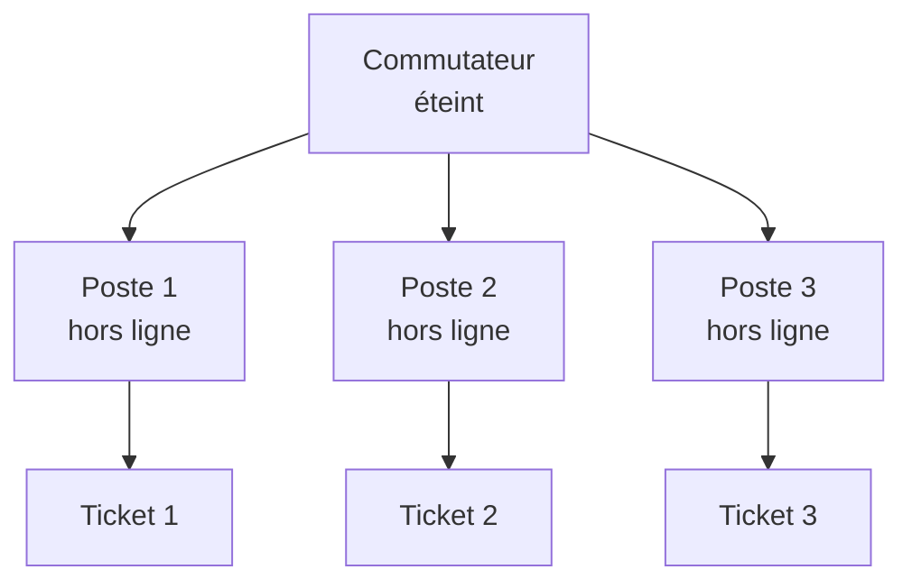

# Cours – Résoudre un incident

*BTS SIO SISR 1re année – S16 – à lire avant le [TP](02-tp.md)*

## À la fin de ce cours, tu sauras

- [ ] décrire le **cycle de vie** d'un incident et ce que le ticket contient à chaque étape ;
- [ ] appliquer la **méthode de diagnostic** (cinq questions, du plus simple au plus complexe) ;
- [ ] distinguer **réalité** et **connaissance de l'outil** ;
- [ ] **corréler** plusieurs tickets avant d'intervenir ;
- [ ] rédiger une **fiche de connaissance** utile à un collègue.

## 1. Le cycle de vie d'un incident

Un incident traverse sept étapes. À chacune correspond ce qu'on ajoute au ticket :

| Étape | Ce qu'on ajoute au ticket |
|---|---|
| 1. Signalement | Rien : le ticket n'existe pas encore |
| 2. Enregistrement | Qui, description, date et heure, équipement concerné |
| 3. Qualification | Catégorie, impact, urgence (donc priorité), niveau, délai applicable |
| 4. Diagnostic | Actions tentées et résultats observés |
| 5. Résolution | Solution appliquée, étapes détaillées |
| 6. Validation | Confirmation de l'utilisateur (date, moyen) |
| 7. Clôture | Temps de résolution, fiche de connaissance à créer |

> [!WARNING]
> **Le ticket se remplit en temps réel, pas de mémoire après coup.** Un ticket rédigé après la résolution perd la chronologie et les **hypothèses écartées**, qui servent pourtant la fois suivante.

**Les canaux.** Un ticket arrive par portail, courriel, téléphone ou passage au bureau. Si le poste est coupé du réseau, le portail est inaccessible : le téléphone est le recours, et le service desk saisit à la place de l'utilisateur. La saisie « brute » est incomplète : à toi de la **compléter** (équipement, qualification).

## 2. Réalité et connaissance de l'outil

Deux choses à ne pas confondre :

- la **réalité** : ce qui existe et fonctionne vraiment (câble branché, alimentation, adresse IP) ;
- la **connaissance de l'outil** : ce que l'agent ou le réseau lui a rapporté.

« **Hors ligne** » dans l'outil veut dire **non joignable par le serveur de gestion**, pas forcément éteint. Le geste central du dépannage est de **comparer** les deux : l'outil dit hors ligne ; la réalité montre quoi ?

Un incident n'est résolu que lorsque le service est constaté rétabli **des deux côtés** : la réalité (ça marche) et l'outil (il revoit l'équipement).

## 3. La méthode de diagnostic

**Du plus simple au plus complexe** : avant de toucher au logiciel, vérifie le câble ; avant le câble, vérifie que la machine est allumée. Cela correspond à une remontée des couches du modèle OSI, de la couche physique vers l'application.

**Cinq questions, dans l'ordre :**

| Question | Ce qu'elle révèle |
|---|---|
| 1. Est-ce que ça a déjà fonctionné ? | Régression ou jamais configuré |
| 2. Qu'est-ce qui a changé récemment ? | Cause immédiate probable (mise à jour, déplacement, nouveau câble) |
| 3. Est-ce reproductible ? | Ponctuel ou permanent |
| 4. Est-ce isolé ou généralisé ? | Un poste → le poste ; plusieurs → réseau ou serveur |
| 5. Y a-t-il un message d'erreur ? | Information directe : **copie-le exactement**, ne le paraphrase pas |

**Une action à la fois.** Si tu en fais deux, tu ne sais pas laquelle a agi.

## 4. Plusieurs tickets, une cause

Quand plusieurs équipements tombent **en même temps**, la cause est rarement chez chacun : elle est le plus souvent **en amont**, dans un élément qu'ils partagent (commutateur, serveur, hôte de virtualisation). Avant d'intervenir poste par poste, **corrèle** : qu'ont-ils en commun ?



Une seule action sur la bonne cause rétablit tout ce qui en dépendait. Chaque ticket garde pourtant **sa propre résolution** et **sa propre vérification** auprès de son utilisateur. Traiter la cause commune est le début de la **gestion des problèmes** (ITIL).

## 5. La base de connaissances

Une **fiche de connaissance** transforme l'expérience d'un technicien en capital collectif : trois mois plus tard, un autre technicien rencontre le même incident et trouve la solution en quelques minutes.

| Section | Contenu |
|---|---|
| Titre | Le symptôme, en une phrase |
| Symptômes | Ce que voit l'utilisateur |
| Causes connues | 1 à 3, les plus fréquentes |
| Solution | Étapes numérotées et précises |
| Vérification | Comment s'assurer que c'est résolu |
| Escalade | Quand passer au niveau supérieur |
| Mots-clés | Pour la recherche |

La **solution d'un ticket** se rédige en quatre éléments : **symptôme constaté**, **cause**, **action réalisée**, **vérification**. Cette solution est la matière première de la fiche.

## 6. Diagnostiquer un poste Windows lent (partie D)

Ordre de la méthode : **ressources**, puis **processus et services**, puis **disque et démarrage**.

| Que vérifier ? | Moyen |
|---|---|
| Processeur, mémoire, disque en direct | Gestionnaire des tâches (Ctrl+Maj+Échap), onglet Performances |
| Processus les plus gourmands | PowerShell (commande ci-dessous) |
| Espace disque | `Get-PSDrive -PSProvider FileSystem` |
| Services automatiques arrêtés | `Get-Service` filtré sur l'état |
| Programmes lancés au démarrage | `Get-CimInstance Win32_StartupCommand` |

```powershell
Get-Process | Sort-Object CPU -Descending | Select-Object -First 10 Name, CPU, WorkingSet
```

> [!NOTE]
> **Commandes et versions.** Le support d'origine employait `wmic`, outil **retiré ou désactivé** dans les versions récentes de Windows. Les commandes PowerShell ci-dessus sont des commandes de référence, à **tester sur la VM de la salle** : note les écarts.

Les seuils de repos souvent cités (processeur sous 80 %, mémoire sous 85 %, disque sous 80 %, plus de 10 % d'espace libre) sont des **repères**, pas des normes : juge toujours **par comparaison** avec un poste sain.

## Détecter avant l'utilisateur : la supervision

La **supervision** consiste à **surveiller en continu** l'état des équipements et des services, à **alerter** quand quelque chose sort de la normale, et à **garder l'historique**. Elle est **proactive** : elle voit parfois la panne **avant** l'utilisateur, ou avant qu'elle n'arrive (disque presque plein).

| Pratique | Question à laquelle elle répond |
|---|---|
| **Inventaire** (S12) | Qu'avons-nous ? |
| **Supervision** | Est-ce que ça marche **maintenant** ? |
| **Dépannage** (cette séance) | **Pourquoi** ça ne marche plus ? |
| **Sauvegarde** (S20) | Peut-on **récupérer** ? |

**Quoi surveiller ?** La disponibilité (ping, port ouvert), le service (page Web, base), les ressources (processeur, mémoire, **espace disque**), des éléments de sécurité (certificat qui expire), un traitement métier (la sauvegarde de la nuit a-t-elle eu lieu ?). On choisit ce qui a un **impact** et on suit la CMDB : services critiques d'abord.

**Comment ?** Une **sonde active** interroge la cible depuis l'extérieur (ping, port TCP, requête HTTP) et voit ce que l'utilisateur voit ; un **agent** installé sur la cible voit l'intérieur ; le protocole **SNMP** (UDP 161) interroge les équipements réseau et les imprimantes. Les anciennes versions de SNMP protègent l'accès par une simple « communauté » en clair ; la version 3 ajoute authentification et chiffrement.

**Seuils et états.** Un seuil fixe quand une mesure devient anormale. On utilise couramment trois états : **OK**, **avertissement**, **critique** (par exemple disque à 80 % puis 90 %). Trop bas, les seuils déclenchent des **fausses alertes** qu'on finit par ignorer ; trop hauts, ils préviennent trop tard. Une alerte dit **quoi**, **où**, **depuis quand**, quelle **gravité**, et vers **qui**. Elle donne un **ticket** (S15) traité selon son SLA (S17).

**Disponibilité mesurée** = temps où le service répond ÷ temps total. Sur 30 jours (43 200 minutes), 99,9 % tolère 43,2 minutes d'arrêt.

**Outils** (licences et versions à vérifier) : Zabbix, Nagios et dérivés, Centreon (complets, plus lourds) ; Uptime Kuma (léger, disponibilité de sites et de ports) ; outils intégrés des hébergeurs.

> [!NOTE]
> InfraLab ne couvre pas la supervision : cette partie se fait en environnement réel (partie E du TP).

## Je retiens

- Sept étapes ; le ticket se remplit **en temps réel**.
- **Hors ligne ≠ éteint** : on compare l'outil et la réalité.
- Cinq questions, **une action à la fois**, du plus simple au plus complexe.
- Plusieurs symptômes simultanés : **chercher la cause commune en amont**.
- Résolu = constaté **des deux côtés** ; chaque ticket a sa solution et sa vérification.
- Une solution bien rédigée devient une **fiche de connaissance**.
- La **supervision** surveille, alerte et garde l'historique : sondes, agents, SNMP, seuils (OK, avertissement, critique).
