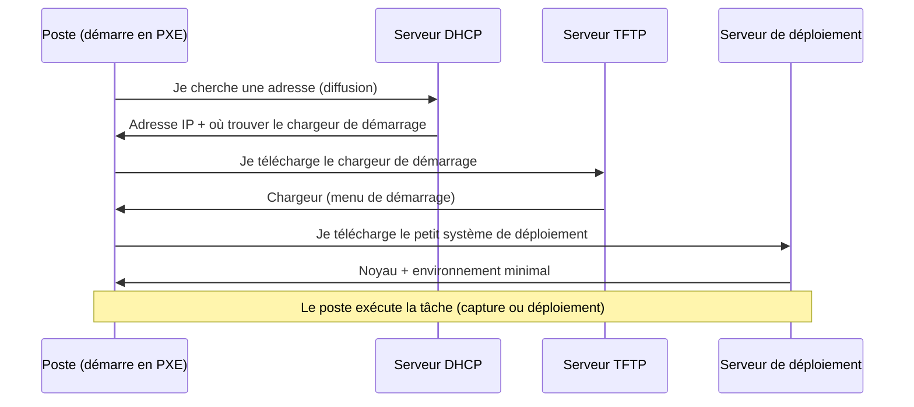

# Cours – Cloner et déployer des postes

*BTS SIO SISR 1re année – S18 – à lire avant le [TP](02-tp.md)*

> [!NOTE] Ce que tu dois savoir déjà
> - **Prérequis :** VM et réseaux de VirtualBox (S06, S07) ; terminal (S08 à S10) ; cycle de vie des équipements (S12) ; la fiche [minimum réseau](../../ressources/minimum-reseau.md).
> - **Mots déjà vus :** DHCP, adresse IP, instantané, VM.
> - **Expliqués dans ce cours :** clonage, démarrage par le réseau (PXE), image maîtresse, identité d'une machine après clonage.

## À la fin de ce cours, tu sauras

- [ ] expliquer le **clonage** et l'intérêt d'une **image maîtresse** ;
- [ ] décrire le **démarrage réseau (PXE)** ;
- [ ] décrire l'architecture et le fonctionnement de **FOG** ;
- [ ] énumérer ce qui doit être **personnalisé** après un clone ;
- [ ] citer les **risques** (sécurité, licences, données personnelles).

## 1. Pourquoi cloner

Installer un poste à la main (système, pilotes, logiciels, réglages) prend du temps, et deux postes « installés pareil » ne le sont jamais tout à fait. Le **clonage** consiste à **préparer un poste modèle une seule fois**, à en **capturer une image**, puis à la **déployer** sur autant de postes que nécessaire.

**Deux mots à connaître.** Le **clonage** consiste à copier à l'identique le disque d'un poste sur d'autres postes. Le poste de départ, installé et réglé avec soin, s'appelle le **poste modèle** ; sa copie enregistrée s'appelle l'**image maîtresse**. Attention : un clone n'est ni un instantané de VM (S07) ni une sauvegarde (S20).

| | Installation à la main | Clonage |
|---|---|---|
| Temps par poste | Long, répété | Court après la préparation du modèle |
| Homogénéité | Variable | Identique par construction |
| Risque d'oubli | Élevé | Faible : tout est dans l'image |
| Point fragile | Chaque poste | **L'image** : une erreur est copiée partout |

> [!NOTE]
> **Ordre de grandeur (à toi de calculer).** Si une installation manuelle dure 2 heures, 30 postes représentent 60 heures de travail. Un clone qui dure 15 minutes par poste, plusieurs postes à la fois, change l'échelle. Les durées réelles dépendent du réseau, des disques et de la taille de l'image.

## 2. Le démarrage réseau : PXE

Un poste neuf n'a pas de système : il doit **démarrer par le réseau**. Le **PXE** (*Preboot Execution Environment*) est ce mécanisme, intégré à la carte réseau.

- **DHCP** : donne l'adresse IP **et** indique le serveur et le fichier de démarrage (options de démarrage réseau, qu'on appelle souvent « next-server » et « nom du fichier de démarrage »).
- **TFTP** : protocole simple de transfert de fichiers, utilisé pour le chargeur.
- **Chargeur** : programme qui affiche le **menu de démarrage** (ici celui de FOG).

> [!WARNING]
> **Un serveur DHCP ne s'ajoute jamais sur un réseau en production sans coordination.** Deux serveurs DHCP sur le même réseau distribuent des adresses contradictoires et peuvent couper des dizaines de postes. En TP, on travaille sur un **réseau interne isolé**.

## 3. FOG, en pratique

**FOG** est une solution libre de **capture et de déploiement d'images**, fonctionnant sur un serveur Linux, avec une **interface web**. D'après sa documentation officielle, elle propose notamment :

- la **capture** et le **déploiement** d'images ;
- la **multidiffusion** : une même image envoyée à plusieurs postes en même temps ;
- des **tâches** applicables après déploiement (renommer l'hôte, joindre un domaine, installer des logiciels) via un **client** à installer sur le poste modèle ;
- un **inventaire** simple des postes enregistrés.

**Composants** : le **serveur** (interface web, base de données, services de démarrage réseau et de transfert) ; le **petit système** téléchargé par le poste pour réaliser l'opération ; le **client FOG** (facultatif) sur les postes.

> [!NOTE]
> **Licence.** La documentation indique que FOG est distribué sous licence GPL, sans préciser la version dans la page consultée : **vérifie** sur le projet avant de citer.

**Prérequis annoncés par la documentation** (à confirmer pour ta version) : un serveur Linux d'une distribution prise en charge, **2 cœurs et 2 Go de mémoire** comme base, une **carte réseau gigabit**, un disque dimensionné selon le nombre d'images conservées (la documentation recommande de placer le dossier des images sur une partition séparée) ; sur les postes, au moins **512 Mo** de mémoire.

**Le parcours (documentation officielle) :**

| Étape | Ce qu'on fait | Où |
|---|---|---|
| 1. Enregistrer le poste modèle | Démarrer en PXE, choisir l'enregistrement rapide | Menu de démarrage FOG |
| 2. Créer l'image | Donner un nom, valeurs par défaut | Interface web, gestion des images |
| 3. Associer l'image au poste | Dans la fiche du poste | Interface web, gestion des hôtes |
| 4. Créer la tâche de capture | Dans la fiche du poste, tâches de base | Interface web |
| 5. Démarrer le poste | Il capture directement, sans afficher le menu | Poste |
| 6. Déployer | Poste cible démarré en PXE, enregistré, tâche de déploiement | Menu puis poste |

Les noms exacts des menus changent selon la version : **note ceux que tu vois**.

## 4. Après le clone : l'identité

Un clone est **identique** au modèle, y compris pour des éléments qui doivent être **uniques** :

| Élément | Problème s'il reste identique | Réponse |
|---|---|---|
| **Nom d'hôte** | Deux machines du même nom sur le réseau | Renommer après déploiement (client FOG ou script) |
| **Adresse IP** | Conflit | Adresses par DHCP |
| **Identifiants du système** (identifiant de session Windows, identifiant de machine sous Linux) | Outils de gestion et de licences qui confondent les machines | Préparer le modèle (sur Windows, la documentation FOG indique `sysprep`) |
| **Clés SSH du serveur** (Linux) | Deux serveurs avec la même identité cryptographique | Les régénérer sur chaque clone |
| **Comptes et mots de passe** | Mot de passe du modèle connu partout | Les changer, ne pas laisser de données personnelles dans le modèle |

> [!NOTE]
> Ces points sont des principes généraux de l'administration système ; leur mise en œuvre dépend du système. **Teste** sur tes VM et note ce qui est identique d'un poste à l'autre.

## 5. Risques et bonnes pratiques

| Risque | Mesure |
|---|---|
| **Image obsolète** (correctifs manquants) | Mettre à jour le modèle et **recapturer** régulièrement ; versionner les images |
| **Image avec données personnelles ou secrets** | Modèle propre : aucun document, mot de passe ou clé d'un utilisateur |
| **Serveur de déploiement compromis** | Il modifie tous les futurs postes : accès réservé, mot de passe par défaut changé, sauvegarde (voir S20) |
| **Licences** | Cloner un système ne dispense pas de **licence** pour chaque poste ; suivre les licences dans l'outil de gestion (S14) |
| **Écrasement** | Le déploiement **remplace** le contenu du disque cible : vérifier la cible avant de lancer |
| **Chiffrement de disque** | Un disque chiffré (Windows : BitLocker) est refusé : le déchiffrer avant capture (documentation FOG) |

**Et après ?** Un poste déployé est un **nouvel équipement** : il doit entrer dans l'**inventaire** (S12 à S14) et son **cycle de vie** doit commencer proprement (S18, partie D d'InfraLab).

## Je retiens

- Clonage = **un modèle soigné**, une **image**, un **serveur** qui la distribue.
- PXE : **DHCP** (adresse + où démarrer), **TFTP** (chargeur), puis le système de déploiement.
- **Pas de second serveur DHCP** sur un réseau de production.
- Un clone est identique : **nom, identifiants, clés** sont à personnaliser.
- Le déploiement **écrase** le disque cible.
- Le poste déployé **entre dans l'inventaire** et commence son cycle de vie.
