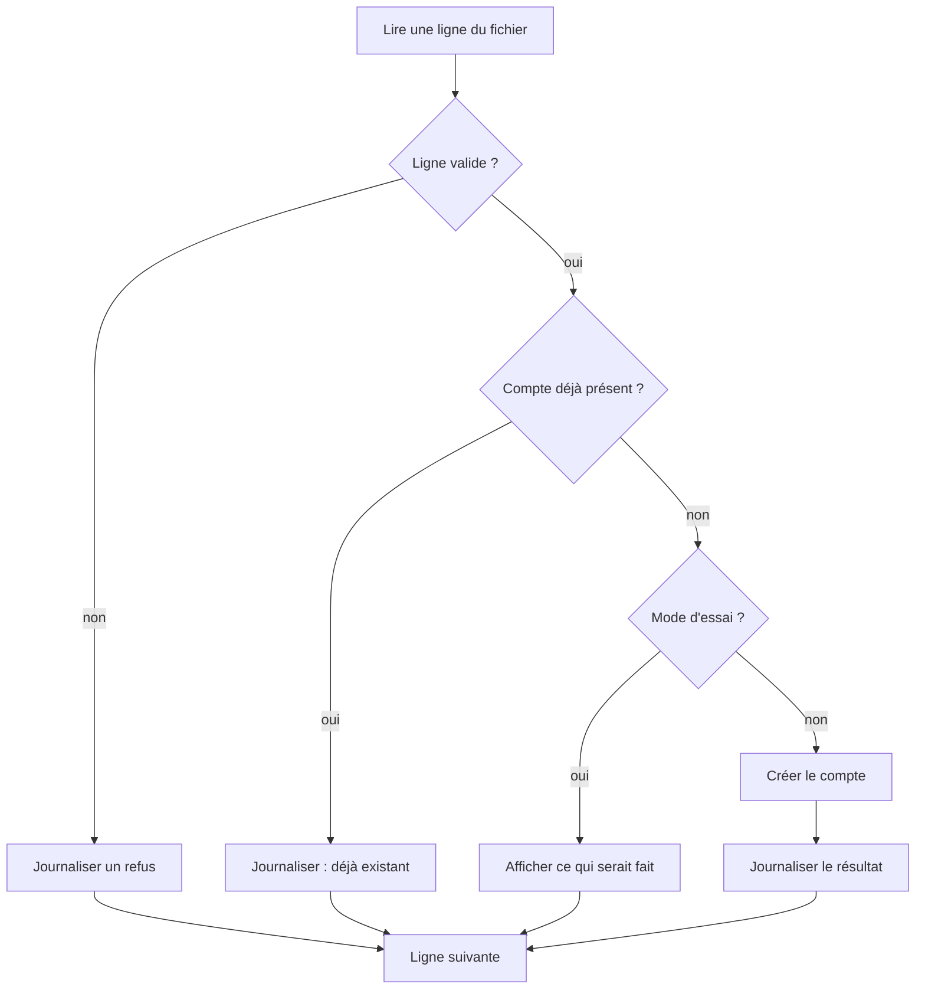

# Cours – Automatiser les tâches d'administration

*BTS SIO SISR 1re année – S19 – à lire avant le [TP](02-tp.md)*

## À la fin de ce cours, tu sauras

- [ ] décider **quand** automatiser une tâche ;
- [ ] citer les qualités d'un script **fiable** ;
- [ ] **planifier** une tâche avec `cron` ;
- [ ] distinguer une approche **impérative** et **déclarative** ;
- [ ] évaluer les **risques** d'un script.

## 1. Pourquoi automatiser

| Gain | Explication |
|---|---|
| **Temps** | Une tâche répétée prend du temps à chaque fois ; un script la fait en secondes |
| **Fiabilité** | Un script fait **toujours la même chose** ; l'humain se trompe quand il répète |
| **Traçabilité** | Un script peut tout **journaliser** |
| **Reproductibilité** | Même résultat sur 1 ou 100 machines |
| **Documentation** | Le script **est** la procédure |

**Mais** : un script se trompe aussi, et **en masse**. Une erreur à la main touche un compte ; une erreur de script touche les 22 d'un coup.

> [!NOTE]
> **Automatiser ou pas ?** Une tâche **fréquente**, **bien comprise**, **stable** et **risquée à la main** mérite un script. Une tâche **rare**, **mal comprise** ou qui demande du **jugement** (arbitrer entre deux demandes, par exemple) ne s'automatise pas : on la **documente** d'abord, on la **fait à la main** plusieurs fois, puis on décide.

## 2. Les qualités d'un script fiable

Tu as vu en [S10](../../semestre-1/S10-paquets-scripts-bash/01-cours.md) les variables, conditions, boucles et le script « relançable ». On ajoute ici :

| Qualité | Question à se poser | Exemple |
|---|---|---|
| **Paramétrable** | Les valeurs changent-elles sans modifier le script ? | Fichier d'entrée en argument |
| **Contrôle des entrées** | Que se passe-t-il avec une donnée **invalide** ? | Ligne vide, identifiant avec espace |
| **Idempotent** | Relancé deux fois, le résultat est-il le même, sans erreur ? | « Créer le compte **s'il n'existe pas** » |
| **Mode d'essai** | Peut-on voir ce qui **serait** fait, sans le faire ? | Option `--test` |
| **Journalisé** | Sait-on **ce qui a été fait**, quand, avec quel résultat ? | Fichier de journal daté |
| **Code de retour** | Une autre tâche peut-elle savoir s'il a **réussi** ? | `exit 0` ou `exit` non nul |
| **Sobre en droits** | Faut-il vraiment être administrateur ? | Limiter `sudo` à ce qui est nécessaire |

**Idempotence.** Une commande est **idempotente** si l'exécuter plusieurs fois donne le même état final qu'une seule fois. C'est la qualité qui rend un script **relançable** après un échec partiel : on le relance, il termine ce qui manquait sans casser ce qui existe.

**Ne jamais mettre de secret dans un script** (mot de passe, clé) : il serait lisible par tous ceux qui lisent le script, son historique et ses sauvegardes.

## 3. Créer des comptes en masse : le principe

Exemple de tâche répétitive : à chaque rentrée, créer les comptes d'une liste d'utilisateurs.

Commandes utiles sous Debian (administrateur) : `useradd` crée un compte ; `getent passwd NOM` ou `id NOM` teste son existence ; `groupadd` et `getent group` pour les groupes ; `userdel -r` supprime un compte et son dossier. Consulte `man useradd` pour les options.

## 4. Planifier : `cron`

`cron` exécute des commandes à **heures fixes**. Chaque utilisateur a sa **table** (`crontab -e` pour l'éditer, `crontab -l` pour la lister).

Une ligne contient **cinq champs de temps**, puis la commande :

| Champ | Valeurs |
|---|---|
| minute | 0 à 59 |
| heure | 0 à 23 |
| jour du mois | 1 à 31 |
| mois | 1 à 12 |
| jour de la semaine | 0 à 7 (0 et 7 = dimanche) |

`*` veut dire « tous » ; `*/5` « toutes les 5 unités ». Exemples : `30 7 * * 1-5` : 7 h 30 du lundi au vendredi ; `*/5 * * * *` : toutes les 5 minutes.

**Pièges classiques :**

- `cron` a un **environnement minimal** : utilise des **chemins absolus** dans la commande et dans le script ;
- la sortie d'un travail planifié doit être **redirigée** vers un fichier, sinon elle est perdue ou envoyée par courriel local ;
- dans une ligne de crontab, le caractère `%` a un sens spécial : il doit être **protégé** par une barre oblique inverse ;
- un travail planifié qui échoue **en silence** est pire qu'une tâche oubliée : on vérifie les journaux.

> [!NOTE]
> Il existe aussi les **minuteries systemd** (*timers*), plus récentes ; on ne les pratique pas ici. Sur une VM minimale, le service `cron` peut ne pas être installé : vérifie.

## 5. Impératif ou déclaratif

| | **Impératif** | **Déclaratif** |
|---|---|---|
| Idée | Décrire les **étapes** | Décrire l'**état voulu** |
| Exemple | Suite de commandes `docker run`, script Bash | Fichier `compose.yaml` |
| Relance | À soigner (idempotence à écrire soi-même) | Naturelle : l'outil compare l'état voulu et l'état réel |
| Partage | Script à lire | Fichier lisible et **versionné** |

**Docker Compose** décrit une application (services, réseaux, volumes) dans **un fichier YAML** et la pilote avec `docker compose up -d` et `docker compose down`. La commande `up` est **idempotente** : relancée alors que rien n'a changé, elle ne recrée rien (constaté dans le TP de DockerLab).

Le **YAML** est un format où l'**indentation par espaces** (jamais de tabulation) exprime l'imbrication.

> [!NOTE]
> Dans l'industrie, on parle d'« **infrastructure décrite par du code** » : le fichier est conservé dans un dépôt, relu, versionné et rejoué. Compose en est une petite illustration ; d'autres outils font de même pour des serveurs entiers.

## 6. Les risques de l'automatisation

| Risque | Mesure |
|---|---|
| Erreur **en masse** | Mode d'essai, test sur peu de données, sauvegarde avant |
| **Droits** excessifs | Principe du moindre privilège |
| **Secrets** en clair | Jamais dans le script ni en argument ; gestion dédiée |
| Script **non maîtrisé** (copié sans lecture) | Lire avant d'exécuter ; garder une trace de la source |
| Script **oublié** qui continue à tourner | Inventaire des tâches planifiées, revue régulière |
| **Absence de journal** | Journaliser, et lire le journal |

## 7. Automatisation et ITIL

Une **demande standard** (S15, S17), prévisible et bien définie, est la candidate idéale à l'automatisation : création de compte, installation d'un logiciel autorisé. Un **changement standard** (pré-approuvé, risque faible, procédure connue) peut aussi être scripté. Mais le **suivi** reste : la demande est **tracée** dans le ticket, même si l'exécution est automatique.

## Je retiens

- On automatise ce qui est **fréquent, compris, stable**.
- Un script fiable : **paramètres, contrôle des entrées, idempotence, essai, journal, code de retour**.
- `cron` : cinq champs de temps, **chemins absolus**, sortie **redirigée**, `%` protégé.
- **Déclaratif** : on décrit l'état voulu (Compose) ; l'outil fait le reste.
- Un script se trompe **en masse** : on teste d'abord et on journalise.
- **Pas de secret** dans un script.
